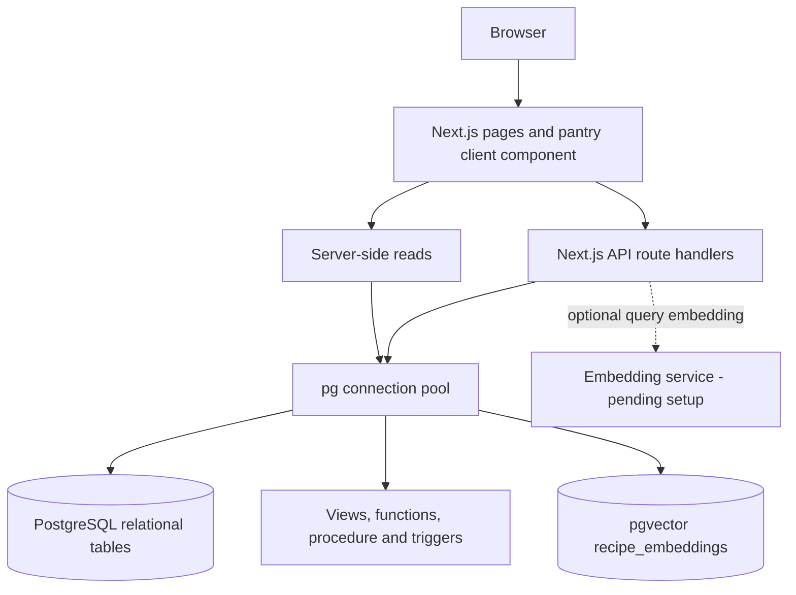

# NutriPantry

### Goal-based recipe recommendations from ingredients you already have

NutriPantry connects pantry management with meal planning. Users can track their
available ingredients and discover recipes ranked by ingredient availability and
calorie fit. PostgreSQL handles the structured data and recommendation rules;
pgvector provides the foundation for a later semantic recipe-search stage.

**DBMS Experiential Learning - Level 3 Mini Project**

| Team member | SRN |
|---|---|
| Ojas Binjola | PES1UG24CS307 |
| Prajin Ravi Shankar | PES1UG24CS328 |

> **Current status:** Intermediate development checkpoint. The repository contains
> SQL schema, seed data, backend routes, authentication and Next.js pages. The
> latest increment adds an interactive pantry interface. Live database verification,
> embedding generation and several final-project requirements remain pending.

## Contents

- [Problem and objectives](#problem-and-objectives)
- [Features and current scope](#features-and-current-scope)
- [Technology stack](#technology-stack)
- [System architecture](#system-architecture)
- [Database model](#database-model)
- [Recommendation approach](#recommendation-approach)
- [Local setup](#local-setup)
- [Application pages and API](#application-pages-and-api)
- [Repository structure](#repository-structure)
- [SQL examples](#sql-examples)
- [Verification and limitations](#verification-and-limitations)
- [Remaining work and report](#remaining-work-and-report)

## Problem and objectives

Planning meals often requires checking which ingredients are available, deciding
what can be cooked, and comparing the meal with a nutrition target. Separating
these tasks can lead to unused food and repeated manual searches.

The project aims to:

1. Maintain a per-user pantry with quantities, units and expiry dates.
2. Identify recipes that overlap with ingredients already in stock.
3. Rank those recipes against the user's active calorie goal.
4. Support a future free-text craving search through recipe embeddings.
5. Demonstrate relational modelling, advanced SQL and application integration
   through a single food-planning workflow.

The current ranking measures ingredient presence and calorie fit. It does not yet
verify that stock quantities satisfy a whole recipe, exclude expired ingredients
from recommendation matching, or optimise meals across all macronutrient targets.

## Features and current scope

| Area | Present in source | Still pending |
|---|---|---|
| Dashboard | Database counts and cuisine aggregates | Live verification |
| Pantry | Inventory, quantity/unit/expiry display, search, category and freshness filters, summary cards | Edit/delete controls and browser verification |
| Pantry writes | Signed-in add/top-up form connected to the existing API and procedure | Live save and isolation tests |
| Recommendations | SQL-based pantry/calorie ranking and a results page | Semantic-search UI and real embedding population |
| Search API | SQL candidates; optional vector re-ranking or full-text fallback | Verified embedding service and complete vector CRUD demonstration |
| Authentication | bcrypt password comparison and signed httpOnly cookie | Stronger session lifecycle and route protection |
| Admin | Application-level admin guard and aggregate views | Database-level role permissions |
| Nutrition goals | Schema, seed data and active-goal lookup | Goal editor |
| Saved recipes | Junction table and seed data | User-facing save/unsave controls |

Anonymous visitors to the pantry and recommendation pages use the seeded demo
account. Pantry writes require authentication. The demo fallback is a checkpoint
convenience and needs revisiting before deployment.

### Pantry behaviour

- Search is case-insensitive and trims surrounding spaces.
- Category and freshness filters combine with the search term.
- Freshness labels come from the SQL view: fresh, expiring within three days,
  expired, or no expiry date set.
- Adding an existing ingredient **increases its quantity**; it does not replace it.
- The form keeps an existing item's unit, or uses the ingredient's default unit.
  It does not convert between units.
- Blank expiry on a top-up preserves the existing expiry date. A supplied date
  replaces it. The model stores one row per user/ingredient, not separate batches.
- Save progress, success/error feedback, empty states and responsive styles are
  included. The database trigger rejects expiry dates already in the past.

## Technology stack

| Layer | Technology | Purpose |
|---|---|---|
| Frontend | Next.js 14.2.5, React 18.3.1 | App Router pages and interactive forms |
| Backend | Next.js Route Handlers | Authentication, pantry, health and recommendation endpoints |
| SQL database | PostgreSQL 16 | Structured data, joins, constraints and transactions |
| Vector storage | pgvector | `vector(384)` recipe embeddings and cosine retrieval scaffolding |
| Database driver | `pg` 8.12.0 | Pooled connections and parameterised queries |
| Password hashing | `bcryptjs` 2.4.3 | Hashed password comparison |
| Local database environment | Docker Compose | PostgreSQL image with pgvector installed |

**Why PostgreSQL?** Users, ingredients, recipes, pantry stock and goals have clear
relationships. Foreign keys, uniqueness rules and transactions help preserve
consistency, while views and stored routines keep important rules near the data.

**Why pgvector?** A craving such as "something creamy and mildly spicy" describes
meaning rather than exact ingredient names. Vector similarity is intended to
re-rank relational candidates using recipe text. It runs inside PostgreSQL, so
this project uses SQL and vector paradigms within one database service.

The planned model is `all-MiniLM-L6-v2` with 384 dimensions. The repository does
not currently bundle a running model service or a completed embedding job.

## System architecture



Server pages read data through `src/lib/db.js`. The pantry client sends writes to
`POST /api/pantry`; the route identifies the signed-in user and calls
`sp_upsert_pantry_item` inside a transaction. User IDs are derived from the session
rather than supplied by the pantry form.

## Database model

The implementation contains **eight relational tables and one vector side-table**.

| Table | Primary key | Responsibility |
|---|---|---|
| `users` | `user_id` | Accounts, password hashes and application roles |
| `ingredients` | `ingredient_id` | Shared ingredient names, categories and default units |
| `pantry_items` | `pantry_item_id` | User-owned stock, quantities, units and expiry |
| `nutrition_goals` | `goal_id` | Daily calorie/macronutrient targets and active periods |
| `recipes` | `recipe_id` | Recipe text, nutrition facts, author and publication status |
| `recipe_ingredients` | `(recipe_id, ingredient_id)` | Recipe-to-ingredient relationship |
| `saved_recipes` | `(user_id, recipe_id)` | User-to-saved-recipe relationship |
| `search_log` | `log_id` | Search text, selected result and ranking score |
| `recipe_embeddings` | `recipe_id` | Source text, model metadata and 384-dimensional vectors |

A user has many pantry items, goals and search-log entries. Recipes and ingredients
have a many-to-many relationship through `recipe_ingredients`; users and saved
recipes are linked through `saved_recipes`. `recipe_embeddings` references a recipe
with a primary key that is also a foreign key.

### SQL implementation

Run order is defined by the numbered files in `nutripantry/db/`:

| File | Database concepts |
|---|---|
| `01_schema.sql` | Extension, tables, primary/foreign keys, UNIQUE/CHECK constraints, ALTER and DROP |
| `02_indexes.sql` | B-tree, composite/partial indexes, generated full-text column, GIN and IVFFlat cosine index |
| `03_views.sql` | Recipe overview, user pantry, pantry matching and ingredient popularity views |
| `04_functions.sql` | Three functions and the pantry upsert procedure |
| `05_triggers.sql` | Pantry validation, active-goal handling and embedding invalidation |
| `06_seed.sql` | Three users, 26 ingredients, eight recipes and related sample data |

The design PDF is available [here](nutripantry/NutriPantry_Database_Design.pdf).
Its types/defaults and diagram still need reconciling with the executable schema.
More command examples are in the [database guide](nutripantry/db/README.md).

## Recommendation approach

### Stage 1: structured SQL ranking

`fn_recommend_recipes(user_id, limit)` combines pantry overlap with calorie fit:

```text
pantry match = matched ingredient count / total recipe ingredient count
meal calorie target = active daily calorie target / 3
SQL score = 0.60 * pantry match + 0.40 * nutrition fit
```

Without an active calorie goal, the function uses 2,000 kcal/day. Nutrition fit
falls as recipe calories move away from the per-meal target. The SQL stage uses
views, joins, correlated ingredient counts and a stored function.

### Stage 2: optional text re-ranking

For an authenticated request with `q`, `/api/recommend` can re-rank SQL candidates:

- With a configured embedding service, it uses pgvector cosine similarity.
- With no embedding service configured, it uses PostgreSQL full-text ranking.
- The result combines `70% SQL score + 30% text/vector similarity` and logs the
  leading result in `search_log`.

Embedding source text is recipe title, description and cuisine. The vector index
uses `vector_cosine_ops`. **`npm run db:embed` currently lists recipes needing
embeddings; it does not generate or insert vectors.** The `/recommend` page
currently displays the SQL stage rather than exposing the API's free-text search.

## Local setup

### Prerequisites

- Node.js 18.17 or later compatible with Next.js 14, with npm.
- Git and VS Code (or another editor).
- Docker Desktop running Linux containers with Docker Compose.
- Port 5432 available for the local PostgreSQL service.

Alternatively, provide PostgreSQL 16 with the pgvector extension installed and
skip the Docker step.

### 1. Open the application folder

From the repository root in the VS Code PowerShell terminal:

```powershell
cd nutripantry
npm ci
```

The package scripts and Compose file live in `nutripantry/`, not at the repository
root. Use `npm ci` to install the versions recorded in the lockfile.

### 2. Configure local environment values

Create the local environment file once; keep an existing configured copy:

```powershell
if (!(Test-Path .env.local)) { Copy-Item .env.example .env.local }
node -e "console.log(require('crypto').randomBytes(32).toString('hex'))"
```

Edit `.env.local`: set your own `PGPASSWORD` and paste the generated random value
into `SESSION_SECRET`. Do not commit the populated file.

| Variable | Purpose |
|---|---|
| `PGHOST` | Database host; `localhost` for the supplied Compose setup |
| `PGPORT` | Database port; default 5432 |
| `PGDATABASE` | Database name; `nutripantry` for Compose |
| `PGUSER` | Database account; `nutripantry` for Compose |
| `PGPASSWORD` | Local database password; choose a non-empty value |
| `SESSION_SECRET` | Secret used to sign authentication cookies |
| `DATABASE_URL` | Optional connection string; takes precedence over individual PG values in the app/setup script |
| `EMBEDDING_API_URL` | Optional service endpoint; leave unset for full-text fallback |
| `EMBEDDING_MODEL` | Model name passed to that service |

For the supplied Compose configuration, keep the database name and user as shown
in `.env.example`. Changing those client values alone does not change the Compose
service's database/user. The embedding endpoint is expected to accept a JSON
`text`/`model` request and return `{ "embedding": [...] }` with 384 values.

### 3. Start the database and load demo data

```powershell
docker compose --env-file .env.local up -d
docker compose --env-file .env.local ps
npm run db:setup
```

Wait until the database reports healthy before running the setup script.
`--env-file .env.local` ensures Docker reads the password used by the app.
A previously initialised database retains its original password.

> `db:setup` drops and recreates the project tables before seeding. Run it only
> against the disposable demo database, not data you want to preserve.

### 4. Start Next.js

```powershell
npm run dev
```

Open [the pantry](http://localhost:3000/pantry) and
[the database health endpoint](http://localhost:3000/api/health).
The health response reports PostgreSQL, pgvector and table information.

For a production build and local production server:

```powershell
npm run build
npm start
```

### Demo accounts

All seeded accounts use the development password **`password123`**.
The seed hash was checked offline; a live login still needs verification.

| Email | Application role |
|---|---|
| `admin@nutripantry.dev` | `admin` |
| `krishna@example.com` | `user` |
| `teammate@example.com` | `user` |

These are sample accounts for a local demonstration. Application roles do not yet
provide database-level role separation.

### Available scripts

| Command | Action |
|---|---|
| `npm run dev` | Start the development server |
| `npm run build` | Create the production build |
| `npm start` | Serve an existing production build |
| `npm run db:setup` | Recreate schema and load seed data |
| `npm run db:embed` | Print recipes awaiting embeddings; pipeline unfinished |

### Troubleshooting

| Symptom | Check |
|---|---|
| Docker cannot connect to its engine | Start Docker Desktop and confirm Linux-container engine readiness. |
| Database connection refused | Check container health, `PGHOST`, `PGPORT` and port conflicts. |
| Password authentication failed | Match app and container passwords; an existing data directory keeps its initial password. |
| `SESSION_SECRET` missing | Configure `.env.local` and restart the development server. |
| `relation does not exist` | Run schema setup against the intended demo database after it is healthy. |
| Extension `vector` unavailable | Use the supplied pgvector image or install pgvector in the manual PostgreSQL instance. |
| No semantic-search results | The embedding table is not populated by the current job; use SQL/full-text behaviour until the pipeline is implemented. |
| Build worker memory failure | Check available memory and retry the build; compilation smoke checks alone do not establish a passing production build. |

## Application pages and API

### Pages

| Path | Purpose |
|---|---|
| `/` | Database counts and cuisine summary |
| `/pantry` | Searchable inventory and signed-in add/top-up form |
| `/recommend` | Stage-1 SQL recommendation results |
| `/login` | Sign-in form |
| `/admin` | Admin-restricted aggregate views |

The current admin page renders a denial message for a non-admin; that is an
application guard, not a verified HTTP 403 response or database permission rule.

### Route handlers

| Method | Endpoint | Authentication | Purpose |
|---|---|---|---|
| GET | `/api/health` | Not required | Database and extension connectivity |
| POST | `/api/auth/login` | Credentials in body | Validate credentials and set session cookie |
| GET | `/api/pantry` | Required | Read the current user's stock |
| POST | `/api/pantry` | Required | Add or top up an ingredient |
| GET | `/api/recommend?q=...&limit=10` | Required | Rank candidates, optionally re-rank text, and log the query |

Example pantry request body:

```json
{
  "ingredientId": 1,
  "quantity": 250,
  "unit": "g",
  "expiryDate": null
}
```

The existing API returns `{ "ok": true }` on a successful pantry write, and an
`error` field on failure. Calls without a session to protected endpoints return
401. There are no pantry PATCH/DELETE, registration, logout or goal-editor API
routes in the current tree.

## Repository structure

```text
DBMS-mini-project/
|-- README.md
|-- .gitignore
`-- nutripantry/
    |-- .env.example
    |-- README.md
    |-- CHECKPOINT.md
    |-- NutriPantry_Database_Design.pdf
    |-- package.json
    |-- package-lock.json
    |-- next.config.mjs
    |-- jsconfig.json
    |-- docker-compose.yml
    |-- db/
    |   |-- README.md
    |   |-- 01_schema.sql
    |   |-- 02_indexes.sql
    |   |-- 03_views.sql
    |   |-- 04_functions.sql
    |   |-- 05_triggers.sql
    |   `-- 06_seed.sql
    |-- scripts/
    |   |-- setup-db.mjs
    |   `-- embed.mjs
    `-- src/
        |-- lib/
        |   |-- auth.js
        |   |-- db.js
        |   `-- embeddings.js
        `-- app/
            |-- layout.jsx
            |-- globals.css
            |-- page.jsx
            |-- login/page.jsx
            |-- pantry/
            |   |-- page.jsx
            |   `-- pantry-workspace.jsx
            |-- recommend/page.jsx
            |-- admin/page.jsx
            `-- api/
                |-- health/route.js
                |-- auth/login/route.js
                |-- pantry/route.js
                `-- recommend/route.js
```

## SQL examples

Run these against the seeded demo database in a SQL client. The examples describe
expected use; they are not recorded execution results.

```sql
-- Pantry inventory and freshness derived by a joined view.
SELECT ingredient_name, quantity, unit, expiry_date, freshness
FROM v_user_pantry
WHERE user_id = 2
ORDER BY ingredient_name;

-- Recommendations through the stored function.
SELECT * FROM fn_recommend_recipes(2, 5);

-- Grouping and aggregation over published recipes.
SELECT cuisine_type, COUNT(*) AS recipes, ROUND(AVG(calories), 0) AS avg_calories
FROM recipes
WHERE is_published = TRUE
GROUP BY cuisine_type
HAVING COUNT(*) > 0
ORDER BY recipes DESC;

-- Full-text search, available independently of generated embeddings.
SELECT title,
       ts_rank(search_tsv, websearch_to_tsquery('english', 'creamy pasta')) AS rank
FROM recipes
WHERE search_tsv @@ websearch_to_tsquery('english', 'creamy pasta')
ORDER BY rank DESC;
```

## Verification and limitations

Checks performed for the pantry increment:

- JSX compilation for the changed pantry modules.
- Server-render smoke checks for guest, signed-in and empty pantry states.
- Controlled handler checks for search/filter/reset, top-up request payload,
  success refresh and 401 feedback with preserved form input.
- Offline bcrypt comparison of the seed password.

The handler checks used mocked API/router behaviour and are not a checked-in test
suite. The last production build attempt failed with a Node worker memory
allocation error; Docker returned an engine error during database verification.
A passing full build, browser validation and live database tests are still pending.

Other implementation limits to address:

- App-level roles exist; database GRANT/role enforcement is not implemented.
- Cookie sessions need stronger lifecycle controls and server-side expiry handling.
- Vector generation/population and full vector CRUD evidence are incomplete.
- Pantry quantities do not support unit conversion or separate purchase batches.
- The installed Next.js 14.2.5 dependency produced a vulnerability warning during
  installation; upgrade and verify it before public deployment.

## Remaining work and report

- [ ] Verify login, pantry writes, trigger rejection and cross-user isolation.
- [ ] Complete pantry editing/deletion and nutrition-goal controls.
- [ ] Add saved-recipe interactions.
- [ ] Implement real embedding generation, ingestion and semantic-search UI.
- [ ] Demonstrate vector CRUD and similarity retrieval with real data.
- [ ] Implement database-level permissions for at least two roles.
- [ ] Add missing SQL demonstrations, including a meaningful CTE.
- [ ] Reconcile the design PDF with the actual schema.
- [ ] Complete browser checks and a passing production build.
- [ ] Capture real application/code screenshots and executed query results.
- [ ] Prepare the final report and accurate individual-contribution notes.

The [checkpoint document](nutripantry/CHECKPOINT.md) maps the **50-mark rubric**
to source evidence and pending work. The final report should include the title
page with course details and student information, abstract, technology stack,
SQL commands, vector commands, Next.js project tree, real screenshots and rubric
completion status. The README supports that report; it is not a completed report.

Further documentation: [application setup notes](nutripantry/README.md) and
[database implementation guide](nutripantry/db/README.md).
