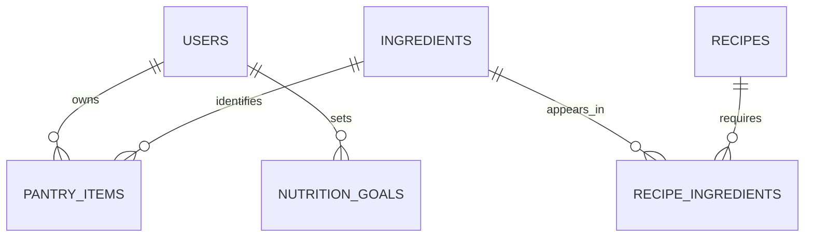

# NutriPantry Pantry Nutrition and Database Access

Prajin Ravi Shankar (PES1UG24CS328)

These sections cover pantry inventory, nutrition goals, and database access for the NutriPantry DBMS project. The recipe and vector sections describe how the recommendation feature uses the pantry and calorie target.

## Relational design

| Table | Key and relationships | Integrity rules |
|---|---|---|
| `users` | `user_id` primary key. One user can have many pantry rows and nutrition goals. | Unique email and an application role constrained to `user` or `admin`. Passwords are stored as bcrypt hashes. |
| `ingredients` | `ingredient_id` primary key referenced by both pantry items and recipe ingredients. | Unique ingredient name, constrained category, and a default measurement unit. |
| `pantry_items` | `pantry_item_id` primary key, with foreign keys to `users` and `ingredients`. | `UNIQUE (user_id, ingredient_id)` gives each user one row per ingredient. The quantity is nonnegative. Deleting the user cascades to owned stock. An ingredient referenced by stock cannot be deleted. |
| `nutrition_goals` | `goal_id` primary key and `user_id` foreign key. | Daily calories must be between 500 and 6000, and an end date cannot precede the start date. Saving a new goal through the app retains the previous row as history. |



## Pantry operations and nutrition goals

| Operation | App entry point | PostgreSQL behavior |
|---|---|---|
| Add and top up | `POST /api/pantry` | Calls `sp_upsert_pantry_item`. The unique user–ingredient key resolves an insert or an atomic addition to the existing quantity. Empty expiry on a top-up keeps the previous date. |
| Read | `GET /api/pantry` and the Pantry page | `v_user_pantry` joins stock to the ingredient catalogue. Its `CASE` expression derives freshness using the database date. |
| Edit | `PATCH /api/pantry` | A parameterized update sets an absolute quantity and expiry date. A blank expiry clears the date. |
| Remove | `DELETE /api/pantry` | A parameterized delete targets a pantry row owned by the signed-in account. |
| Set or replace goal | `POST /api/goals` | The transaction acquires a per-user advisory lock before inserting the new goal. The insert trigger retires the previous active goal. Recommendation SQL reads the active daily calorie value. |

The pantry validation trigger runs before inserts and updates. It rejects dates in the past and normalizes the unit. The procedure and view let the team demonstrate database behavior alongside the forms. Because a pantry row has one quantity and expiry date, the app tracks stock per ingredient and does not track expiry by purchase batch. The form records macronutrient targets, while the existing recommendation score uses calories.

## Database roles and row-level security

The app validates the signed session and supplies its account ID to PostgreSQL through a transaction-local setting. Pantry and goal requests switch to `nutripantry_member` with `SET LOCAL ROLE`. PostgreSQL applies row-level security to both tables. `USING` restricts visible and modifiable rows. `WITH CHECK` restricts the owner on inserted or updated rows. The pantry view uses its caller's permissions so the same restriction applies through the view.

The Admin page checks the application role before switching to `nutripantry_admin_report`. PostgreSQL grants that role read access to the report views. A member role cannot select those views, and the reporting role has no pantry write grant. Both roles and the account setting are scoped to a transaction, which prevents one request's role or account ID from carrying over to another request on the pool.

```sql
BEGIN;
SET LOCAL ROLE nutripantry_member;
SELECT set_config('nutripantry.user_id', '2', true);
SELECT DISTINCT user_id FROM v_user_pantry;
ROLLBACK;
```

The shared connection still uses the existing database setup account for other flows, including dashboard and recipe queries. The database restrictions demonstrated here apply to pantry, goals, and admin reporting. The application is responsible for supplying the trusted user ID from the session.

## SQL checks and results

The demonstration script is [pantry_access.sql](../db/demo/pantry_access.sql). It uses the seeded accounts, performs its writes in a transaction, and rolls them back at the end.

For a fresh demo database, `npm run db:setup` applies the numbered SQL files in order. For an existing Compose database, run these commands from the `nutripantry` directory to apply only the permissions and run the demonstration.

```powershell
Get-Content -Raw db/08_access.sql | docker compose --env-file .env.local exec -T db psql -v ON_ERROR_STOP=1 -U nutripantry -d nutripantry
Get-Content -Raw db/demo/pantry_access.sql | docker compose --env-file .env.local exec -T db psql -v ON_ERROR_STOP=1 -U nutripantry -d nutripantry
```

Apply the permissions with the database setup account, which must be able to create roles and alter the pantry and goal tables.

| Check | Observed result |
|---|---|
| Query the pantry view with no explicit owner filter under the member role | Only owner 2 was visible. |
| Attempt to update user 3's pantry as user 2 | Zero rows changed. |
| Add 2 g, top up by 3 g, then replace the quantity with 7 g and clear the expiry | The result matched 5 g after top-up and 7 g with no expiry after edit. Deletion then removed the row. |
| Assign a past expiry date | PostgreSQL rejected the update through the trigger. |
| Insert a goal for another account | PostgreSQL denied the insert through row-level security. |
| Save a 1,950 kcal goal | Exactly one goal remained active. After rollback, the seed goal was 2,200 kcal. |
| Read the report as a member, then as the reporting role | The member was denied. The reporting role read 26 rows and was denied direct pantry updates. |
| Execute the existing pantry recommendation function after rollback | Masala Omelette remained the top seeded recommendation. |

These results were reproduced with the combined branch's schema and seed on a disposable PostgreSQL 18.6 instance in PGlite with pgvector 0.8.7. Ojas's separate recipe and embedding evidence is reported in his sections.

## Application checks and screenshots

A Chrome run against the combined app verified demo sign-in, add, top-up, quantity replacement, invalid expiry feedback, removal, separate pantries for the two member accounts, and persistence of the 1,950 kcal goal after reload. The signed-out pantry API returned 401. The member saw the Admin page's denial message, and the admin account could read both report views.

| Evidence | What it shows |
|---|---|
| [Pantry after editing chickpeas](evidence/pantry.png) | Signed-in pantry controls, updated 150 g quantity, expiry status and save feedback. |
| [Saved nutrition goal](evidence/nutrition-goal.png) | The calorie and macro fields after reloading the page. |
| [Admin reports](evidence/admin.png) | Ingredient popularity and recipe catalogue views loaded under admin reporting access. |

## Demo sequence

1. Sign in as Krishna and open Pantry. Add 100 g of chickpeas, top up by 25 g, and replace the quantity with 150 g. Submit a past expiry date to show the trigger message, then clear it and save.
2. Save a 1,950 kcal goal and show the value after reloading. Remove the test ingredient when its new quantity is no longer needed for the recommendation demonstration.
3. Show the SQL role demo's owner filter and denied administration query. Sign in as Admin to show the report views.
4. Switch to Ojas's recommendation demo with the same seeded setup. Retain the pantry change or goal through the handoff if the team wants to show how they affect ranking.

## Combined verification

The Next.js production build passed after combining the pantry permissions with Ojas's recipe-search changes. The embedding job stored vectors for all 16 recipes. With the saved 1,950 kcal target, a hybrid search for "warm comforting vegetarian curry" ranked Chana Masala first with a score of 0.9362. The vector CRUD script inserted a temporary soup recipe, found it by similarity, invalidated and regenerated its vector after a text edit, then removed it. The script ended with 16 recipes and 16 embeddings.
